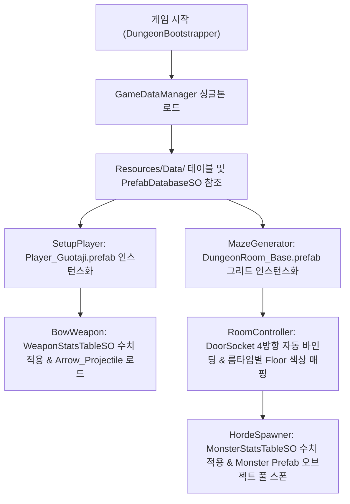

# 거타지의 전설: 프리팹 및 데이터 테이블(시트) 아키텍처

## 1. 개요 (Overview)
기존 런타임 절차적 프리미티브 생성(Primitive) 방식을 **완전한 Unity Prefab 로딩 파이프라인**으로 전환하고, 모든 게임 플레이 수치(플레이어, 무기, 몬스터, 던전)를 **ScriptableObject 테이블 및 외부 편집 가능한 CSV 시트**로 분리하여 데이터 주도형(Data-Driven) 설계를 완성했습니다.

---

## 2. 프리팹 시스템 구조 (Prefab Architecture)

모든 프리팹은 `Assets/_MythOfGuotaji/Resources/Prefabs/` 경로에 저장되며, `PrefabDatabaseSO`를 통해 중앙 관리됩니다. 에셋 누락 시에도 게임이 멈추지 않도록 강력한 Fallback 루틴이 내장되어 있습니다.

| 프리팹 명칭 | 파일 경로 | 주요 컴포넌트 및 구성 |
|---|---|---|
| **Player_Guotaji** | `Resources/Prefabs/Player_Guotaji.prefab` | `CharacterController`, `PlayerController`, `BowWeapon`, `DaggerWeapon`, 청색 무사 도포 머티리얼, 태그: `Player` |
| **Arrow_Projectile** | `Resources/Prefabs/Arrow_Projectile.prefab` | `Projectile`, `SphereCastAll` 0.4m 스윕 검출체, `Rigidbody` (Kinematic), 비행 실린더 메시 |
| **Monster_Minion** | `Resources/Prefabs/Monster_Minion.prefab` | `CharacterController`, `MonsterAI` (LoS + BFS 길찾기), 적색 요괴 틴트 |
| **Monster_Elite** | `Resources/Prefabs/Monster_Elite.prefab` | `CharacterController`, `MonsterAI` (열쇠 드랍 수문장, 1.5배 크기, 황금 틴트) |
| **Monster_FoxBoss** | `Resources/Prefabs/Monster_FoxBoss.prefab` | `CharacterController`, `MonsterAI` (보스 여우 요괴, 2.2배 크기, 주황 틴트) |
| **Companion_Howon** | `Resources/Prefabs/Companion_Howon.prefab` | `CharacterController`, `CompanionAI` (플레이어 호위 및 원거리 사격 지원) |
| **DoorSocket** | `Resources/Prefabs/DoorSocket.prefab` | `DoorSocket`, 좌/우 코너 고정 벽체, 중앙 개폐벽, 전투/보스 봉인 배리어, 기둥 |
| **DungeonRoom_Base**| `Resources/Prefabs/DungeonRoom_Base.prefab`| `RoomController`, 39m(150% 확장) 바닥 메시, 방 진입 감지 BoxCollider, 4방향(N,E,S,W) DoorSocket |

---

## 3. 데이터 테이블 및 시트 관리 구조 (Data Table & Sheet System)

수치 밸런스를 유니티 인스펙터 및 외부 스프레드시트(Excel / Google Sheets)에서 직관적으로 관리할 수 있도록 2중 파이프라인을 지원합니다.

### 3.1 ScriptableObject 테이블 (`Resources/Data/`)
- **`PlayerStatsTableSO`**: 거타지의 기본 체력, 이동 속도, 대시 회피 속도/지속시간/쿨다운.
- **`WeaponStatsTableSO`**: 
  - 활(Bow): 기본 피해량, 초당 연사속도, 치명타율/배율, 멀티샷 발사수/각도, 관통 수치, 넉백, 화살 비행 속도/수명/충돌반경.
  - 단검(Dagger): 긴급 탈출 피해량, 150도 부채꼴 사거리, 쿨다운, 넉백 파워.
- **`MonsterStatsTableSO`**: 산해경 잡몹, 정예 수문장, 구미호 보스의 체력, 이속, 공격력, 사거리, 쿨다운, 인연포인트 및 골드 보상, 크기 배율, 틴트 컬러.
- **`DungeonConfigTableSO`**: $6 \times 6$ 그리드 크기(36개 방), 방 규격(39m), 벽 높이, 문 너비, 순환 루프 비율, 방 타입별 몬스터 스폰 수.
- **`PrefabDatabaseSO`**: 게임 내 사용되는 모든 프리팹 에셋 레퍼런스 카탈로그.

### 3.2 CSV 시트 파이프라인 (`DataSheets/`)
게임 기획자가 유니티 에디터를 열지 않고도 엑셀이나 구글 시트로 편집할 수 있는 CSV 파일들을 제공합니다:
- `Assets/_MythOfGuotaji/DataSheets/PlayerStats.csv`
- `Assets/_MythOfGuotaji/DataSheets/WeaponStats.csv`
- `Assets/_MythOfGuotaji/DataSheets/MonsterStats.csv`
- `Assets/_MythOfGuotaji/DataSheets/DungeonConfig.csv`

---

## 4. 원클릭 에디터 메뉴 도구 (Editor Tools)

유니티 상단 메뉴바의 `MythOfGuotaji` 메뉴에서 즉시 실행할 수 있습니다:

1. **`MythOfGuotaji` > `Generate All Prefabs and Tables`**
   - 모든 8종 프리팹 자동 조립 및 저장 (`Resources/Prefabs/`)
   - 4종 밸런스 테이블 에셋 자동 생성 및 기본값 초기화 (`Resources/Data/`)
   - CSV 시트 자동 추출 (`DataSheets/`)
   - `PrefabDatabaseSO`에 모든 생성된 프리팹 자동 연결

2. **`MythOfGuotaji` > `Data` > `Export All Tables to CSV Sheets`**
   - 현재 인스펙터 상의 ScriptableObject 밸런스 데이터를 외부 CSV 시트 파일로 덮어쓰기 저장.

3. **`MythOfGuotaji` > `Data` > `Import All CSV Sheets to Tables`**
   - 외부에서 수정한 CSV 시트 파일들을 읽어들여 ScriptableObject 테이블에 일괄 반영 및 저장.

---

## 5. 런타임 프리팹 로딩 및 의존성 주입 흐름

