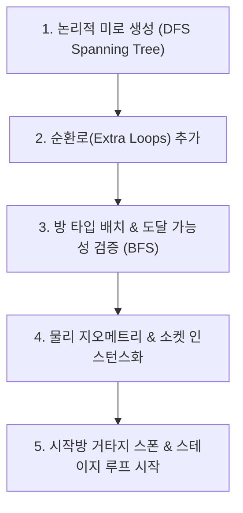

# 🏛️ 03. 절차적 미로 던전 생성 시스템 (Phase 2)

본 문서는 《거타지의 전설》의 $N \times N$ 정사각형 그리드 기반 절차적 미로 던전 생성 알고리즘, 규격화된 방 소켓 구조, 혼합형(일반 자유/특수방 잠금) 문 제어 메커니즘을 다룹니다.

---

## 1. 미로 생성 알고리즘 파이프라인 ([MazeGenerator.cs](file:///c:/__Works__/_MythOfGuotaji_/MythOfGuotaji/Assets/_MythOfGuotaji/Scripts/Dungeon/MazeGenerator.cs))

### 단계별 상세 동작
1. **DFS Spanning Tree 생성**:
   * $(0, 0)$에서 시작하여 모든 $N \times N$ 방이 단 하나의 트리 구조로 연결되도록 무작위 깊이 우선 탐색(DFS) 진행.
2. **순환로(Cycle) 추가 (`_extraLoopRatio = 0.25`)**:
   * 단순 트리는 외길 통로가 많아 원거리 슈팅 시 벽에 막히기 쉬우므로, 인접한 방 사이에 통로를 25% 확률로 추가 개방하여 **회피 및 카이팅이 가능한 원형 순환 경로**를 형성.
3. **고정 및 특수 방 배치**:
   * **시작방 (`Start`)**: $(0, 0)$에 고정 (안전 구역).
   * **보스방 (`Boss`)**: $(N-1, N-1)$에 고정 (여우 요괴 거처).
   * **열쇠방 (`KeyRoom`)**: BFS 탐색을 통해 시작방에서 거리 2 이상 떨어진 방 중 하나를 열쇠방으로 지정하여 **소프트 락(불가능한 맵) 원천 방지**.
   * **함정방 (`Trap`)**: 미로 중간에 1~2개 배치.

---

## 2. 방 규격화 및 소켓 구조 ([DoorSocket.cs](file:///c:/__Works__/_MythOfGuotaji_/MythOfGuotaji/Assets/_MythOfGuotaji/Scripts/Dungeon/DoorSocket.cs))

* **규격화 표준**:
  * 방 크기: 가로 $26\text{m} \times$ 세로 $26\text{m} \times$ 높이 $4.5\text{m}$ (한 변 길이 변경 시 일괄 적용).
  * 4방향 소켓: **북(N), 동(E), 남(S), 서(W)** 위치에 규격화된 소켓 배치.
* **4가지 소켓 상태 (`DoorState`)**:
  * `Wall`: 연결되지 않은 외벽/막힌 벽.
  * `Open`: 자유 통과가 가능한 개방 통로.
  * `CombatLock`: 함정/전투 발생 시 내려오는 붉은 차단벽.
  * `BossLock`: 보스방 전용 황금빛 봉인벽 (보스방 열쇠 보유 시 개방 가능).

---

## 3. 혼합형(Hybrid) 방 진입 및 전투 로직 ([RoomController.cs](file:///c:/__Works__/_MythOfGuotaji_/MythOfGuotaji/Assets/_MythOfGuotaji/Scripts/Dungeon/RoomController.cs))

* **일반 미로방 (`Normal`)**:
  * 플레이어가 진입해도 **문이 잠기지 않습니다**.
  * 방과 방 사이를 가로지르며 요괴들을 넓은 맵에서 몰이사냥(Kiting) 가능.
* **함정방 (`Trap`)**:
  * 플레이어가 진입하는 순간 4개 방향의 연결 통로가 즉시 잠기며(`CombatLock`), 대규모 요괴 웨이브가 발생합니다.
  * 웨이브를 모두 격파하면 문이 다시 열리고 통과할 수 있습니다.
* **열쇠방 (`KeyRoom`)**:
  * 플레이어 진입 시 문이 잠기며 정예 수문장 요괴와 호위 무리가 스폰됩니다.
  * 정예 요괴 처치 시 **보스방 열쇠(Boss Key)**를 드롭하며 문이 열립니다.
* **보스방 (`Boss`)**:
  * 열쇠를 보유하지 않으면 들어갈 수 없으며(`BossLock`), 열쇠를 보유한 상태로 진입 시 문이 잠기고 **최종 보스 여우 요괴**와의 결전이 시작됩니다.

---

## 4. 챕터별 테마 스킨 ([ChapterThemeSO.cs](file:///c:/__Works__/_MythOfGuotaji_/MythOfGuotaji/Assets/_MythOfGuotaji/Scripts/Dungeon/ChapterThemeSO.cs))

* 방의 구조적 콜라이더/소켓 데이터와 시각적 머티리얼/프리팹을 분리.
* `ChapterThemeSO`를 통해 챕터 1(서해 작도 해안 요괴굴), 챕터 2(서역 사막 마굴), 챕터 3(청구 여우 본거지) 등 스킨만 손쉽게 교체할 수 있습니다.
