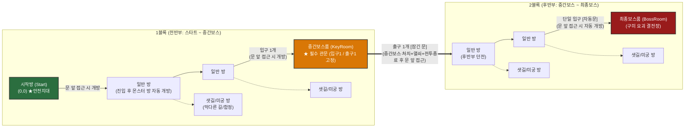
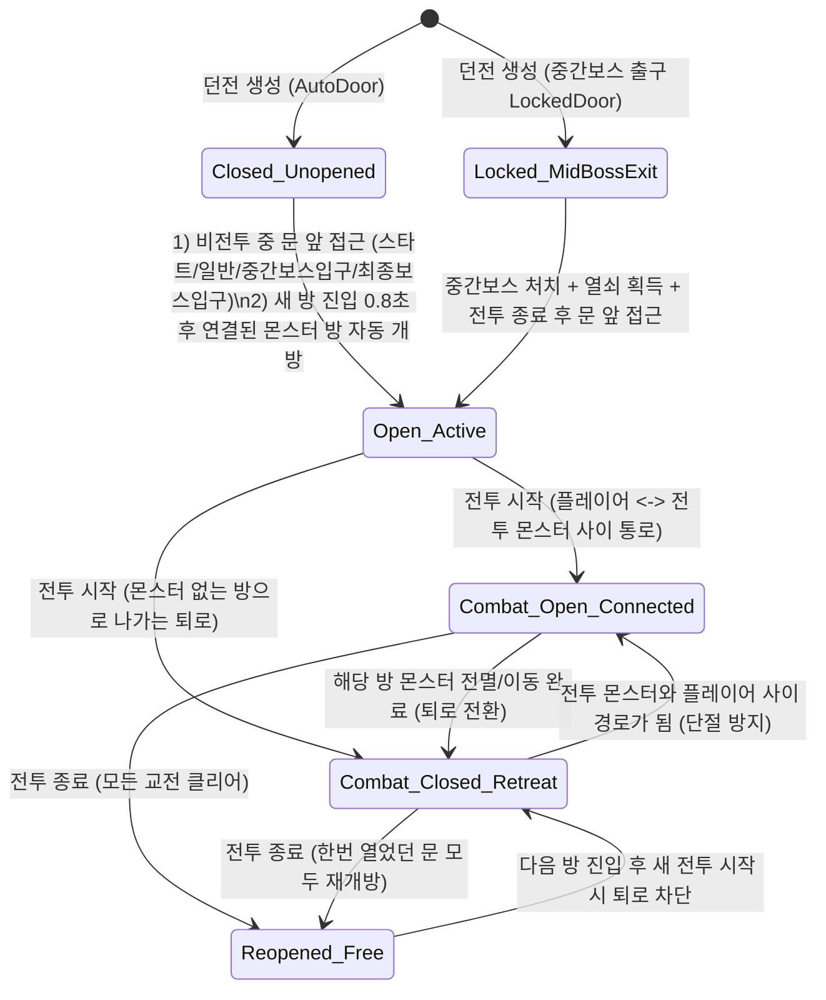

# 🏛️ 03. 절차적 2블록 미궁 던전 시스템 및 10대 방문(Door) 정책 규격

본 문서는 《거타지: 인연의 화살》의 절차적 던전 생성 아키텍처, 2블록 선형 흐름 및 중간보스 관문(Bottleneck), 스테이지별 최소 칸수 보장 테이블, 그리고 **10대 던전 방문(Door) 개폐 및 전투 정책**을 총망라합니다.

---

## 1. 던전 구조 및 2블록 선형 흐름도

---

## 2. 2블록 선형 미궁 생성 및 관문(Gate) 규칙

### 2.1 블록 1: 스타트룸 $\rightarrow$ 중간보스룸 (Block 1)
* **스타트 룸 안전지대 고정 (규칙 1)**: `(0, 0)` 좌표에 생성되는 시작방(`RoomType.Start`)은 몬스터가 절대 스폰되지 않는 100% 안전지대입니다.
* **메인 경로 전진**: 테이블에 지정된 `minRoomsBlock1` 이상의 일반 방들을 유기적으로 배치합니다.
* **중간보스 관문 배치 (규칙 4)**:
  - 1블록의 마지막 메인 방 끝에 중간보스방(`RoomType.KeyRoom`)을 배치합니다.
  - 중간보스방의 문은 **들어오는 문 1개(1블록 연결), 나가는 문 1개(2블록 연결) 총 2개로 엄격히 고정**되며 어떠한 샛길도 중간보스방에 직접 연결되지 않습니다.

### 2.2 블록 2: 중간보스룸 $\rightarrow$ 최종보스룸 (Block 2)
* **중간보스 뒷문 잠금 (규칙 3 & 8)**:
  - 중간보스방에서 2블록 첫 방으로 나가는 유일한 출구 문만 **잠긴 문(`DungeonDoorType.LockedDoor`, `DoorState.BossLock`)**으로 설정됩니다.
  - 중간보스를 처치하여 열쇠를 획득하고 **해당 방의 전투가 완전히 끝난 뒤**, 문 앞으로 다가가야만 봉인이 해제되며 열립니다.
* **최종보스룸 배치 (규칙 3 & 7)**:
  - 2블록의 종착점에 최종보스방(`RoomType.Boss`)을 단일 입구로 배치합니다.
  - 최종보스방 입구는 잠긴 문이 아닌 **자동으로 열리는 문(`DungeonDoorType.AutoDoor`)**이며, 단 인접 방 진입 시 원격으로 열리지 않고 플레이어가 문 앞에 직접 다가갔을 때 자동으로 열립니다.

---

## 3. 10대 던전 방문(Door) 개폐 및 전투 정책 상세

| 규칙 번호 | 정책 항목 | 상세 동작 및 구현 규칙 | 관련 클래스 / 메서드 |
|:---:|---|---|---|
| **규칙 1** | **스타트 룸 안전지대** | `RoomType.Start`는 몬스터 미스폰, 웨이브 미발생, 초기 클리어(`_isCleared = true`) 및 비전투 상태(`IsInCombat = false`) 보장 | `RoomController.SetupRoom`, `PreSpawnMonsters` |
| **규칙 2** | **문의 2대 종류 구분** | 모든 통로 문은 **자동으로 열리는 문(`DungeonDoorType.AutoDoor`)**과 **잠긴 문(`DungeonDoorType.LockedDoor`)** 두 가지로 구분 | `DungeonEnums.cs`, `DungeonAutoDoor.cs` |
| **규칙 3** | **잠긴 문 위치 교체 (중간보스 뒷문)** | 던전의 모든 문은 기본 자동문(`AutoDoor`)이며, 오직 **중간보스방 $\rightarrow$ 후반부(2블록) 연결 출구 문**만 잠긴 문(`BossLock`)으로 설정. 최종보스방 입구는 자동문(`Open`)으로 동작 | `MazeGenerator.IsMidBossExitDoor`, `CreateRoomInstance` |
| **규칙 4** | **중간보스 관문 고정 (입구 1 / 출구 1)** | 던전 생성 시 `KeyRoom`의 개방 방향 수를 검증하여 **1블록에서 들어오는 문 1개, 2블록으로 나가는 문 1개(총 2개)**로 고정 | `MazeGenerator.GenerateTwoBlockLinearMaze` |
| **규칙 5** | **스타트 룸 첫 문 개방 조건** | 스타트 룸에서는 방 진입 타이머로 문이 열리지 않으며, 플레이어가 **문 가까이(4.8m 이내) 다가갔을 때** 열림 | `DungeonAutoDoor.Update`, `RoomController.Update` |
| **규칙 6** | **문 개방 시 몬스터 자동 전투 시작** | 어떤 방식으로든 방문이 열렸을 때 연결된 방에 살아있는 몬스터가 있다면, 즉시 해당 방 인카운터 시작(`StartCombatEncounter`), 플레이어 전투 상태 전환(`SetInCombat(true)`), 전 몬스터 어그로(`TriggerAggro`) 발동 | `DoorSocket.OnAutoDoorOpened`, `RoomController.StartCombatEncounter` |
| **규칙 7** | **새 방 진입 후 연결된 몬스터 방 자동 개방 (보스/중간보스 입구 예외)** | 새로운 일반/함정 방 내부 진입 후 잠시 뒤(`0.8초`), 그 방과 연결된 방들 중 **몬스터가 있는 방의 문은 모두 자동으로 개방**됨. 단, **중간보스방 입구(`KeyRoom`)**와 **최종보스방 입구(`Boss`)**는 예외로 문 앞에 가야만 열림 | `RoomController.Update`, `OpenUnopenedConnectedDoors` |
| **규칙 8** | **중간보스방 출구 개방 조건** | 중간보스 처치 및 열쇠 획득(`HasBossKey = true`) 즉시 원격 개방되지 않으며, **남은 잔당까지 처치하여 해당 전투가 끝난 뒤(`!IsInCombat`) 문 앞에 가야만** 황금 봉인이 해제되며 열림 | `GameManager.AcquireBossKey`, `RoomController.OnKeyEliteDefeated`, `DungeonAutoDoor.Update` |
| **규칙 9** | **전투 중 퇴로 차단 및 캐릭터-몬스터 단절 방지** | 1) 새로운 방에 진입해 전투가 시작되면 **몬스터가 없는 뒤쪽 방으로 나가는 퇴로 문은 즉시 닫힘(`CloseByCombat`)**. 2) 단, **플레이어가 있는 방과 전투 중인 몬스터(또는 스폰 예정 웨이브)가 있는 방 사이의 통로 문**은 BFS 경로 추적을 통해 항상 열림 유지(`ForceOpen`)되며, 문턱(`2.4m`)에 캐릭터/몬스터가 걸쳐 있을 때는 통과 직후 닫혀 **서로 단절되는 일을 100% 방지** | `MazeGenerator.UpdateDungeonDoorPolicy`, `GetDoorPairsConnectingPlayerToMonsters`, `DungeonAutoDoor.IsActorInDoorway` |
| **규칙 10** | **전투 종료 후 열린 문 일괄 재개방** | 교전 중인 모든 몬스터가 처치되어 전투가 종료되면, 전투 중 퇴로 차단으로 닫혔던 **한 번이라도 열었던 모든 문(`HasEverBeenOpened == true`)이 즉시 다시 열림(`ReopenAfterCombat`)** | `MazeGenerator.CheckAndEndCombatIfAllCleared`, `ReopenAllOpenedDoorsAfterCombat` |

---

## 4. 방문(Door) 상태 전이 다이어그램

