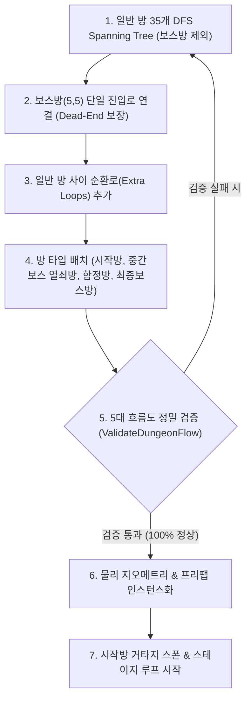
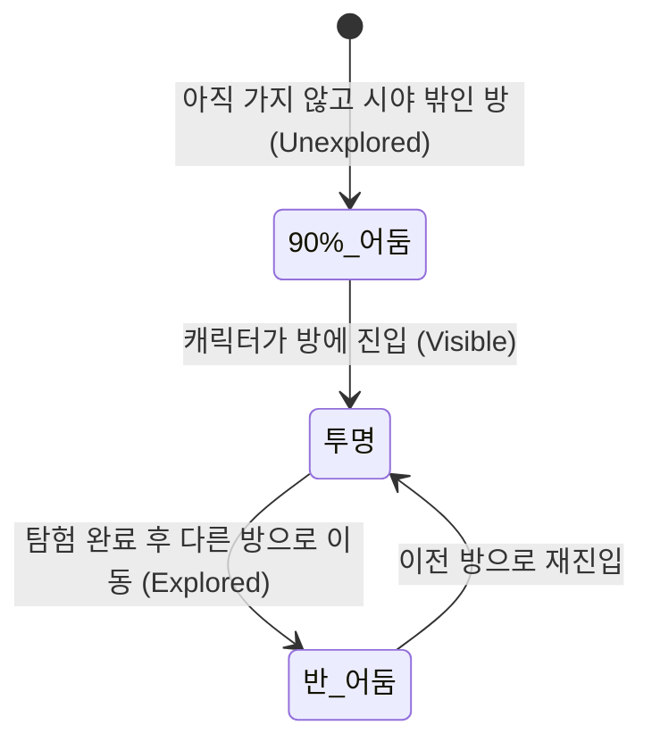
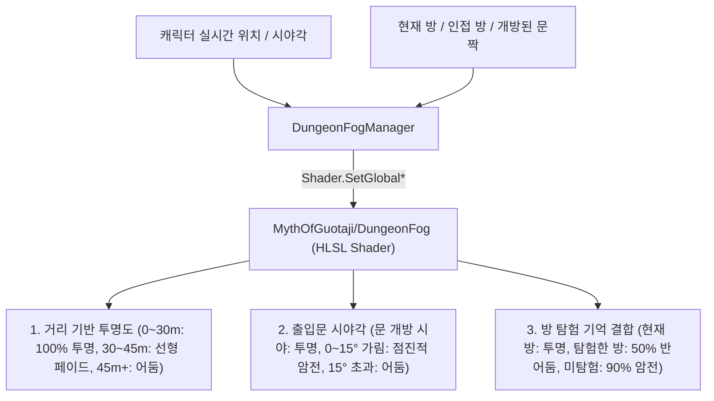

# 🏛️ 03. 절차적 미로 던전 생성 시스템 (Phase 2)

본 문서는 《거타지의 전설》의 $6 \times 6$ 정사각형 그리드(총 36개 방) 기반 절차적 미로 던전 생성 알고리즘, 개별 방 150% 확장($39\text{m} \times 39\text{m}$), 시작 $\rightarrow$ 중간보스 $\rightarrow$ 최종보스 정밀 흐름도 검증 시스템 및 혼합형(일반 자유/특수방 잠금) 문 제어 메커니즘을 다룹니다.

---

## 1. 미로 생성 및 무결성 검증 파이프라인 ([MazeGenerator.cs](file:///c:/__Works__/_MythOfGuotaji_/MythOfGuotaji/Assets/_MythOfGuotaji/Scripts/Dungeon/MazeGenerator.cs))

### 단계별 상세 동작
1. **보스방 제외 일반 방 DFS Spanning Tree 생성**:
   * $(0, 0)$에서 시작하여 $(N-1, N-1)$ 보스방을 **완전히 제외한 35개 일반 방**만을 대상으로 무작위 깊이 우선 탐색(DFS) 진행.
   * 이를 통해 35개 모든 방이 서로 100% 연결된 단일 연결 그래프(Connected Graph)를 형성.
2. **보스방 단일 통로 연결 (Dead-End 보장)**:
   * 보스방은 인접한 방(남쪽 또는 서쪽) 중 단 1곳과만 통로를 연결합니다.
   * **원천 차단 효과**: 보스방이 미로의 경유지(Hallway)로 쓰이지 않으므로, **"보스방을 지나야만 도달할 수 있는 방"이 구조적으로 0개(절대 발생 불가)**가 됩니다.
3. **순환로(Cycle) 추가 (`_extraLoopRatio = 0.25`)**:
   * 일반 방들 사이에만 순환 통로를 추가 개방하여 슈팅 액션 시 **회피 및 카이팅이 가능한 원형 순환 경로**를 형성 (보스방은 제외하여 단일 진입로 유지).
4. **고정 및 특수 방 배치**:
   * **시작방 (`Start`)**: $(0, 0)$에 고정 (안전 구역).
   * **보스방 (`Boss`)**: $(5, 5)$에 고정 (여우 요괴 거처).
   * **중간보스방 (`KeyRoom`)**: 보스방을 통과하지 않는 BFS 최단 경로를 탐색하여 시작방으로부터 거리 3 이상, 보스방 바로 앞 입구가 아닌 방으로 엄선 배치.
   * **함정방 (`Trap`)**: 미로 중간에 2~3개 분산 배치.
5. **5대 흐름도 정밀 검증 (`ValidateDungeonFlow`)**:
   * ① 시작방에서 보스방을 거치지 않고 모든 35개 일반 방에 도달 가능한가?
   * ② 보스방 뒤에 갇혀있거나, 보스방을 지나야만 갈 수 있는 방이 0개인가?
   * ③ 중간보스(열쇠방)가 존재하며 보스방을 거치지 않고 도달 가능한가?
   * ④ 중간보스 처치 후 보스방 입구로 도달하는 유효 경로가 확보되어 있는가?
   * ⑤ 인접한 모든 방의 문 개폐 상태가 상호 일치(Reciprocal)하는가?
   * 위 5가지 검증이 100% 통과할 때까지 자동 재생성(최대 50회)하여 **소프트 락이나 막힌 벽을 원천 제거**합니다.

---

## 2. 방 규격화 및 소켓 구조 ([DoorSocket.cs](file:///c:/__Works__/_MythOfGuotaji_/MythOfGuotaji/Assets/_MythOfGuotaji/Scripts/Dungeon/DoorSocket.cs))

* **규격화 표준**:
  * 타일 수: 가로 6칸 $\times$ 세로 6칸 = **총 36개 방** (기존 $4 \times 4$에서 가로세로 2칸씩 확장).
  * 방 크기: 가로 $39\text{m} \times$ 세로 $39\text{m} \times$ 높이 $4.5\text{m}$ (기존 26m 대비 **150% 확장**되어 시원한 슈팅 시야 및 넓은 전투 반경 확보).
  * 4방향 소켓: **북(N, +19.5m), 동(E, +19.5m), 남(S, -19.5m), 서(W, -19.5m)** 위치에 규격화된 소켓 배치.
* **4가지 소켓 상태 (`DoorState`)**:
  * `Wall`: 연결되지 않은 외벽/막힌 벽.
  * `Open`: 자유 통과가 가능한 개방 통로 (너비 6.0m).
  * `CombatLock`: 함정/전투 발생 시 내려오는 붉은 차단벽.
  * `BossLock`: 보스방 전용 황금빛 봉인벽 (중간보스 정예 수문장을 처치하여 열쇠 획득 시 양방향 자동 해제).

---

## 3. 12m 확장형 자동 개폐 문 및 영구 개방 규칙 ([DungeonAutoDoor.cs](file:///c:/__Works__/_MythOfGuotaji_/MythOfGuotaji/Assets/_MythOfGuotaji/Scripts/Dungeon/DungeonAutoDoor.cs))

* **12m 2배 확장 개구부 (`DoorWidth = 12.0m`)**:
  - 기존 6m 너비의 좁은 문에서 **12m 너비(기존 대비 2배)**로 대폭 확장되어 넓은 시야 확보 및 대규모 요괴 무리와의 원활한 이동 전투 지원.
* **한번 열린 문 영구 개방 (Permanent Door Opening)**:
  - **"한번 열린 문은 열쇠가 있건 없건 이제 영원히 닫히지 않는다."**
  - 플레이어가 문 $7.0\text{m}$ 이내로 접근하여 문이 좌우로 슬라이딩 개방되면, 해당 문은 `_isPermanentlyOpen = true` 및 `_isPermanentlyUnlocked = true`로 고정됩니다.
  - 전투 인카운터가 시작되거나 플레이어가 멀리 벗어나더라도 절대 다시 닫히거나 봉인 장벽이 생기지 않습니다.
  - 보스방 문 역시 열쇠로 잠금을 해제하여 열린 이후에는 결전 도중에도 영구 개방 상태가 유지됩니다.

---

## 4. 몬스터 스폰 룰 및 30초 3웨이브 전투 시스템 ([RoomController.cs](file:///c:/__Works__/_MythOfGuotaji_/MythOfGuotaji/Assets/_MythOfGuotaji/Scripts/Dungeon/RoomController.cs))

* **문 개방 즉시 1차 공격 개시**:
  - 스타트룸(또는 이전 탐험 방)에서 문을 열면, **문을 연 방에서 미리 사전 스폰되어 있던 몬스터들(웨이브 1)이 즉시 플레이어를 향해 먼저 공격**을 개시합니다.
  - 문 개방과 동시에 해당 방의 전투 인카운터가 활성화되고 30초 웨이브 타이머가 작동합니다.
* **전투 시작 30초 뒤 2차 추가 웨이브 스폰**:
  - 전투가 시작되고 **30초 경과 시**, 처음 스폰되었던 몬스터들의 생존 여부와 관계없이(처음 스폰되었던 몬스터들과 별도로) **동일한 숫자의 추가 웨이브(웨이브 2)**가 같은 방에 생성되어 플레이어를 협공합니다.
* **다시 30초 뒤 3차 최종 웨이브 스폰 및 스폰 종료**:
  - 전투 시작 **60초 경과(2차 웨이브 후 30초 뒤)** 시점에 **동일한 숫자의 3차 웨이브**가 스폰되며, 해당 방의 웨이브 스폰은 완전히 종료됩니다.
* **방 클리어 판정**:
  - 3차 웨이브까지 모든 스폰이 종료된 후, 방 안에 남은 모든 요괴 무리를 소탕하면 해당 방의 클리어(`_isCleared = true`)가 확정됩니다.

---

## 5. 지면 예고 UI (Telegraph) 수명 주기 무결성 검증

* 잡몹 2m 돌진 예고 사각형(`Minion_DashTelegraph`), 거북이 90도 휩쓸기 부채꼴(`SweepTelegraph`), 주(鴸) 5m 원형 폭발 가이드(`Zhu_CircleTelegraph`)는 몬스터가 공격 시전 중 또는 피격 피드백 도중 사망하더라도 **`MonsterAI.Die()`, `MonsterAI.OnDisable()`, `ZhuParabolicProjectile.OnDisable()`에서 즉시 감지하여 100% 잔여물 없이 안전 소멸**되도록 생명주기 관리가 일원화되었습니다.

---

## 4. 3단계 던전 포그(Fog of War) 시스템 ([RoomFogOverlay.cs](file:///c:/__Works__/_MythOfGuotaji_/MythOfGuotaji/Assets/_MythOfGuotaji/Scripts/Dungeon/RoomFogOverlay.cs), [DungeonFogManager.cs](file:///c:/__Works__/_MythOfGuotaji_/MythOfGuotaji/Assets/_MythOfGuotaji/Scripts/Dungeon/DungeonFogManager.cs))

쿼터뷰 탑다운 시점에 최적화된 고성능 3-Tier 암흑 차폐 렌더링 파이프라인:

* **1단계 - 투명 (`Visible`, Alpha = 0.0)**:
  * 현재 캐릭터가 위치한 방 및 시야가 미치는 공간.
  * 어둠이 0%로 걷혀 지형, 바닥, 몬스터, 사물 전체가 온전히 선명하게 렌더링됨.
* **2단계 - 반 어둠 (`Explored`, Alpha = 0.5)**:
  * 이전에 방문/탐험했던 방이지만 현재 시야에서 벗어난 방.
  * 50% 반투명 암흑 슈라우드가 드리워져 방의 구조와 길은 인지할 수 있으나 어둡게 음영 처리됨.
* **3단계 - 90% 어둠 (`Unexplored`, Alpha = 0.9)**:
  * 아직 한 번도 가보지 않은 미지의 방.
  * 90%의 짙은 암흑 슈라우드로 가려져 실루엣만 희미하게 느껴지는 미지의 영역.
* 방 간 이동 시 `Mathf.MoveTowards`를 통해 각 방의 투명도가 부드럽게 페이드 전환됩니다.

---

## 5. 몬스터 사전 스폰 및 방 경계면 시야 / 영구 추적 AI ([MonsterAI.cs](file:///c:/__Works__/_MythOfGuotaji_/MythOfGuotaji/Assets/_MythOfGuotaji/Scripts/Actor/MonsterAI.cs), [RoomController.cs](file:///c:/__Works__/_MythOfGuotaji_/MythOfGuotaji/Assets/_MythOfGuotaji/Scripts/Dungeon/RoomController.cs))

* **사전 스폰(Pre-Spawning) 방식**:
  * 방에 들어갈 때 몬스터가 눈앞에 갑자기 생성되는 팝인 현상을 완전히 제거.
  * 던전 생성 즉시 시작방을 제외한 모든 주변 방들에 요괴들이 **미리 스폰되어 방 안을 자유롭게 배회(Wander)**하고 있습니다.
* **시야 및 인식(Aggro) 메커니즘**:
  * **비인식 상태**: 캐릭터를 보지 못했을 때는 플레이어를 쫓지 않고 자기 방 안에서 평화롭게 서성이거나 대기합니다.
  * **방 경계면(Boundary) 시야 감지**:
    * 플레이어가 몬스터가 있는 방으로 진입했을 때 즉시 인식.
    * 인접 방에서 열린 통로(문짝이 열려있거나 없는 상태)를 통해 $24\text{m}$ 이내 직시선(Line of Sight)이 확보되었을 때 즉시 인식. (닫힌 문짝 너머는 시야 차단)
* **영구 추격(Relentless Pursuit)**:
  * **"한 번 캐릭터가 인식되면 그 이후는 죽을 때까지 쫓아갑니다."**
  * 한번 어그로가 발동된 요괴는 방을 벗어나 멀리 도망쳐도 절대 추격을 포기하지 않으며, BFS 미로 경로 탐색과 휘스커 장애물 우회를 통해 문과 복도를 넘어 끝까지 플레이어를 추격합니다.

---

## 6. 혼합형(Hybrid) 방 진입 및 인카운터 로직

* **일반 미로방 (`Normal`)**:
  * 플레이어가 진입해도 **문이 잠기지 않습니다**.
  * 방과 방 사이를 가로지르며 요괴들을 넓은 맵에서 몰이사냥(Kiting) 가능.
* **함정방 (`Trap`)**:
  * 플레이어가 진입하는 순간 4개 방향의 연결 통로가 즉시 잠기며(`CombatLock`), 대규모 요괴 웨이브가 발생합니다.
  * 웨이브를 모두 격파하면 문이 다시 열리고 통과할 수 있습니다.
* **열쇠방 (`KeyRoom`)**:
  * 플레이어 진입 시 문이 잠기며 정예 수문장 요괴와 호위 무리가 스폰됩니다.
  * 정예 요괴 처치 시 **보스방 열쇠(Boss Key)**를 드롭하며 문이 열립니다.
* **보스방 (`Boss`)**:
  * 열쇠를 보유하지 않으면 들어갈 수 없으며(`BossLock`), 열쇠를 보유한 상태로 진입 시 문이 잠기고 **최종 보스 여우 요괴**와의 결전이 시작됩니다.

---

## 4. 챕터별 테마 스킨 ([ChapterThemeSO.cs](file:///c:/__Works__/_MythOfGuotaji_/MythOfGuotaji/Assets/_MythOfGuotaji/Scripts/Dungeon/ChapterThemeSO.cs))

* 방의 구조적 콜라이더/소켓 데이터와 시각적 머티리얼/프리팹을 분리.
* `ChapterThemeSO`를 통해 챕터 1(서해 작도 해안 요괴굴), 챕터 2(서역 사막 마굴), 챕터 3(청구 여우 본거지) 등 스킨만 손쉽게 교체할 수 있습니다.

---

## 7. URP 전용 던전 포그 셰이더 ([DungeonFog.shader](file:///c:/__Works__/_MythOfGuotaji_/MythOfGuotaji/Assets/_MythOfGuotaji/Shaders/DungeonFog.shader))

던전의 긴장감과 탐험의 재미를 극대화하기 위해 유니티 URP(Universal Render Pipeline) 기반의 전용 커스텀 셰이더와 런타임 매니저가 통합되었습니다.

### 1) 거리 기반 투명도 감쇄 (Distance Visibility Falloff)
* **$0\text{m} \sim 30\text{m}$**: 완전 투명 ($0.0$). 캐릭터 주변 30m 이내는 시야 장애 없이 선명하게 표시됩니다.
* **$30\text{m} \sim 45\text{m}$**: 선형 점진적 불투명 페이드 ($\frac{\text{dist} - 30}{45 - 30}$).
* **$45\text{m}$ 이상**: 완전 어둠 ($1.0 \times \text{\_MaxDarkness}$).

### 2) 문 기준 시야각 체크 (Doorway Vision Angle & Occlusion)
* **시야각 원추(Vision Cone)**: 캐릭터 위치에서 개방된 출입문(너비 $6.0\text{m}$, 반너비 $3.0\text{m}$)을 통과하는 시야각을 역삼각함수(`atan2`)로 정밀 계산합니다.
* **문 가림 페이드**:
  * **문 개방 각도 내부 ($\Delta\theta \le 0^\circ$)**: 완전 개방 ($0.0$, 문 너머 인접 방 시야 확보).
  * **문에 가려진 $0^\circ \sim 15^\circ$**: 점진적으로 불투명해지는 선형 페이드 ($\frac{\Delta\theta}{15.0}$).
  * **$15^\circ$ 초과 가림각**: 완전 어둠 ($1.0$). 문틀 및 벽 너머 시야 완전 차단.
* **자동문 연동**: 문짝이 닫혀있는 경우 해당 문의 유효 너비가 $0$으로 취급되어 문 너머 시야가 100% 어둠으로 차단됩니다. 문에 접근하여 문짝이 열리면 즉시 시야 원추가 형성되어 방 너머가 보입니다.

### 3) 캐릭터 전방 160도 시야각 및 후방(뒷면) 10m~15m 차단 ([DungeonFogConfigSO.cs](file:///c:/__Works__/_MythOfGuotaji_/MythOfGuotaji/Assets/_MythOfGuotaji/Scripts/Dungeon/DungeonFogConfigSO.cs))
* **전방 160도 판정**: 캐릭터의 마우스 조준 전방 벡터(`_CharacterForward`) 기준 반각 $80^\circ$ ($\cos(80^\circ) \approx 0.1736$) 시야 원추를 계산합니다.
  * **전방 160도 ($|\theta| \le 80^\circ$)**: 시야 체크가 정상 수행되어 거리(0~30m 투명, 30~45m 페이드) 및 개방된 문 투과에 따라 가시 영역이 확장됩니다.
* **후방 10m~15m 감쇄 (뒷면 차단 및 전방향 10m 보장)**:
  * **$0\text{m} \sim 10\text{m}$ (항상 가시 영역)**: 캐릭터 주변 $10\text{m}$는 전방/후방 불문 **항상 완전 투명($0.0$)**하게 보여 주변 상황을 파악할 수 있습니다.
  * **$10\text{m} \sim 15\text{m}$ (후방 점진적 페이드)**: 160도 전방 시야각을 벗어난 뒷면 영역은 $10\text{m}$부터 $15\text{m}$까지 선형으로 어두워집니다.
  * **$15\text{m}$ 이상 (후방 완전 암전)**: $15\text{m}$를 벗어난 후방 공간은 $100\%$ 암전 차단되어 보이지 않습니다.
* **경계면 소프트 페이드 (`_FovSoftness = 0.05`)**: 160도 경계선에 `smoothstep`을 적용하여 자연스러운 시야각 음영 그라데이션 형성.

### 4) 던전 포그 ScriptableObject 테이블 ([DungeonFogConfigSO.cs](file:///c:/__Works__/_MythOfGuotaji_/MythOfGuotaji/Assets/_MythOfGuotaji/Scripts/Dungeon/DungeonFogConfigSO.cs))
포그와 관련된 모든 거리, 각도, 색상 수치는 `DungeonFogConfigSO` 에셋 파일(`Resources/Data/DungeonFogConfig.asset`)로 완전 분리되어 에디터 인스펙터에서 즉시 튜닝 가능합니다:
* `fogColor`: 포그 기본 색상 (기본값: 흑남색 `RGB(0.015, 0.015, 0.025)`)
* `maxDarkness`: 최대 불투명도 (기본값 `0.90`)
* `exploredDarkness`: 탐험했던 방 반어둠 불투명도 (기본값 `0.50`)
* `fovAngleDegrees`: 전면부 시야각 (기본값 `160.0°`)
* `clearDistance`: 전방 완전 투명 거리 (기본값 `30.0m`)
* `falloffDistance`: 전방 완전 암전 거리 (기본값 `45.0m`)
* `alwaysClearRadius`: 캐릭터 주변 상시 가시 반경 (기본값 `10.0m`)
* `rearDarkDistance`: 후방 완전 암전 시작 거리 (기본값 `15.0m`)
* `doorFadeAngle`: 문 가림 시야각 페이드 범위 (기본값 `15.0°`)

