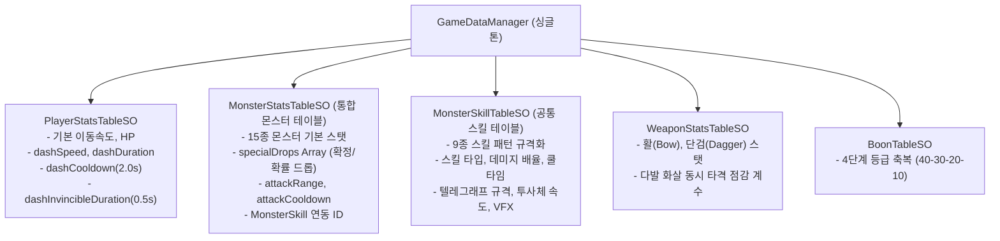

# 📦 06. 프리팹 및 데이터 테이블 아키텍처 (Prefab & Data Table Architecture)

본 문서는 《과타지의 전설》의 데이터 중심 아키텍처(Data-Driven Architecture), 통합 몬스터 스탯 및 스킬 테이블, 플레이어 스탯 테이블, 그리고 UGUI 프리팹 구조를 총망라합니다.

---

## 1. 데이터 테이블 구조도 (Data Table Architecture)

---

## 2. 통합 몬스터 테이블 ([MonsterStatsTableSO.cs](file:///c:/__Works__/_MythOfGuotaji_/MythOfGuotaji/Assets/_MythOfGuotaji/Scripts/Data/MonsterStatsTableSO.cs))

기존의 분산되어 있던 스탯 및 VFX 정보를 일원화하고, 각 몬스터가 보유한 기본 공격 및 특수 스킬(MonsterSkillTable 참조 ID), 드롭 테이블, 특수 드롭(array)을 정의합니다.

### 2.1 스펙 정의
* **기본 정보**: `monsterType`, `monsterName`, `description`, `tier`
* **Stats**: `maxHp`, `moveSpeed`, `attackDamage`, `attackRange`, `attackCooldown`, `knockbackPower`, `kiteDistance`
* **공격 및 스킬 연동**:
  - `normalAttackSkillId`: 기본 공격 스킬 ID
  - `specialSkillId`: `MonsterSkillTableSO`에 정의된 특수 기믹 스킬 ID
* **Special Drops Array (`MonsterDropEntry[]`)**:
  - `itemId`: 보스 열쇠(`BossKey`), 영혼 보석, 특수 유물 등
  - `dropChance`: 드롭 확률 ($0.0 \sim 1.0$)
  - `minAmount`, `maxAmount`: 드롭 수량

---

## 3. 공통 몬스터 스킬 테이블 ([MonsterSkillTableSO.cs](file:///c:/__Works__/_MythOfGuotaji_/MythOfGuotaji/Assets/_MythOfGuotaji/Scripts/Data/MonsterSkillTableSO.cs))

유사한 공격 패턴을 여러 몬스터가 재사용하고 확장할 수 있도록 공통 구조화한 스킬 전용 ScriptableObject입니다.

### 3.1 스킬 타입 (`MonsterSkillType`)
1. `DashAttack`: 미니언 고속 돌진 (5m 돌진, 70cm 충격파)
2. `HeavyCharge`: 멧돼지 및 거북이 장거리 돌진 (15~20m 가이드라인 돌진)
3. `RangedProjectile`: 맹독충 등의 직선 원거리 투사체
4. `ParabolicBomb`: 주(鴸)의 5m 원형 장판 포물선 곡사 폭격
5. `ParryReflect`: 도깨비 화염술사의 패링 핑퐁 반사 투사체
6. `TetherPull`: 요선 거미의 영혼 사슬 견인 (슬라이딩 탈출)
7. `ShieldGuard`: 흑철 방패병의 전면 가드 (풀차징 화살로만 파괴)
8. `EnergyAbsorb`: 영력 흡수 괴물의 차징 공격 흡수 치유 및 거대화
9. `KamikazeExplode`: 자폭 참새의 12m/s 초고속 쇄도 및 자폭
10. `TurretBarrage`: 사방신 토템의 4방향 회전 탄막
11. `AreaCleave`: 여우 보스의 180도 광역 반월 베기
12. `VacuumPull`: 여우 보스의 25m 부채꼴 진공 흡인
13. `RollingBoulder`: 정예 요괴의 20m 굴러가는 바위

---

## 4. 플레이어 스탯 테이블 ([PlayerStatsTableSO.cs](file:///c:/__Works__/_MythOfGuotaji_/MythOfGuotaji/Assets/_MythOfGuotaji/Scripts/Data/PlayerStatsTableSO.cs))

과타지의 기동성 및 슬라이딩 무적 스펙을 관리합니다.
* `moveSpeed`: `7.5 m/s`
* `dashSpeed`: `16.0 m/s`
* `dashDuration`: `0.22 s` (실제 고속 이동 지속 시간)
* **`dashCooldown`**: **`2.0 s`** (슬라이딩 쿨타임)
* **`dashInvincibleDuration`**: **`0.5 s`** (슬라이딩 중 데미지 완전 무효화 i-frame)

---

## 5. UGUI 프리팹 시스템

* **Boon 선택 윈도우 프리팹**:
  - 경로: `Assets/_MythOfGuotaji/Prefabs/GUI/BoonSelectWindow.prefab`
  - Canvas (RenderMode: Screen Space - Overlay)
  - 4단계 등급별 시각 색상 지원:
    - 일반(흰색/연노랑, 40%) $\rightarrow$ 희귀(파란색, 30%) $\rightarrow$ 영웅(보라색, 20%) $\rightarrow$ 전설(황금빛 노란색, 10%)
  - 선택창 활성화 시 캐릭터 마우스 추적 회전 락(`_isInputLocked = true`) 적용
* **3중 체력 프로그레스바**:
  - 화면 최하단 중앙 위치 (폭 400px, 높이 30px)
  - 1계층(배경): 붉은색 막대 (데미지 시 손실된 체력 영역 노출)
  - 2계층(회복 예고): 노란색 막대 (체력 회복 시 즉시 차오른 후 1초 뒤 초록 막대가 채워짐)
  - 3계층(현재 체력): 선명한 초록색 막대 (현재 실시간 체력 비율)
