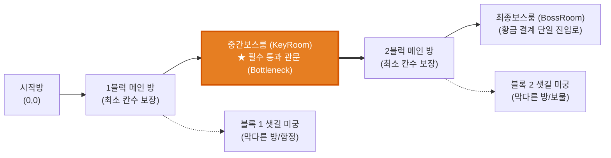

# 📜 프로젝트 전체 리뷰 및 최신 사양서 (Project Review & Specifications)

* **버전**: v1.6.0 (Two-Block Linear Maze, Dynamic Door Combat Policy & Totem Upgrade)
* **갱신 일자**: 2026-10-24
* **상태**: 핵심 시스템 구현 완료, 컴파일 오류 0개, 빌드 검증 완료

---

## 1. 최신 시스템 개요 (Executive Summary)

1. **2블록 선형 미궁 던전 아키텍처**:
   - 고정 정사각형 그리드를 탈피하고 유기적인 비정방형 미궁으로 전환.
   - **1블럭 (스타트룸 $\rightarrow$ 중간보스룸)**: 최소 방 개수를 거쳐 중간보스방에 도달.
   - **중간보스 필수 관문 (Bottleneck)**: **중간보스룸을 통과(가로지르기)하지 않으면 2블럭(최종보스)으로 갈 수 없는 구조 확립**.
   - **2블럭 (중간보스룸 $\rightarrow$ 최종보스룸)**: 중간보스룸 출구에서 출발하여 최소 방 개수를 거쳐 최종보스방에 도달.
   - **미궁 샛길/막다른 방(Branches)**: 각 블록 메인 경로에서 뻗어나오는 막다른 방들을 배치하여 탐험성과 미궁 느낌 유지.
   - **스테이지별 설정 테이블 ([`DungeonStageTableSO.cs`](file:///c:/__Works__/_MythOfGuotaji_/MythOfGuotaji/Assets/_MythOfGuotaji/Scripts/Data/DungeonStageTableSO.cs))**: 스테이지별 최소 칸수(1스테이지: 1칸/3칸, 2스테이지: 2칸/3칸 등)와 샛길 방 개수를 제어.
2. **방문(Door) 개폐 정책 고도화**:
   - **캐릭터 상태**: `전투 중 (In Combat)` vs `비전투 중 (Out of Combat)`.
   - **비전투 상태**: 새로운 문이든 이전 문이든 자유롭게 개방 가능 (한꺼번에 여러 개도 개방 가능).
   - **전투 시작 시**: **열린 지 30초가 넘지 않은 문은 자동으로 폐쇄되어 퇴로가 차단**됨 (현재 방에서 후진 불가).
   - **비전투 전환 시**: 방 요괴 전멸 시 전투로 닫혔던 문들이 **자동으로 다시 열려 이전 방으로 후진 가능**.
3. **사방신 토템(Totem_Turret) 정책 개편**:
   - **일반 공격 면역**: 주인공의 화살이나 단검 평타에는 데미지 0 (완전 면역).
   - **패링 탄환 전용 타격**: 오직 패링된 자신 또는 다른 몬스터의 투사체(`isReflected`)로만 피해 적용.
   - **접근 후 고정 포대화**: 전투 시작 시 첫 대포를 쏠 때까지는 플레이어를 향해 걸어서 이동(2.4m/s)하며, 사거리에 도달하여 첫 포탄을 발사한 순간 그 자리에 멈춰 더 이상 움직이지 않고 탄막을 난사.
4. **13종 몬스터 던전 랜덤 스폰 풀**:
   - 일반 방/웨이브에서 13종의 잡몹/기믹 몬스터가 고유 색상 및 크기로 다채롭게 출현.
5. **대형 에임 포인터 커서 & 화면 영역 제한 (Confined)**:
   - 64x64 크기의 선명한 고대비 크로스헤어 커서 및 창 밖 이탈 방지 모드 적용.

---

## 2. 던전 진행 구조도

