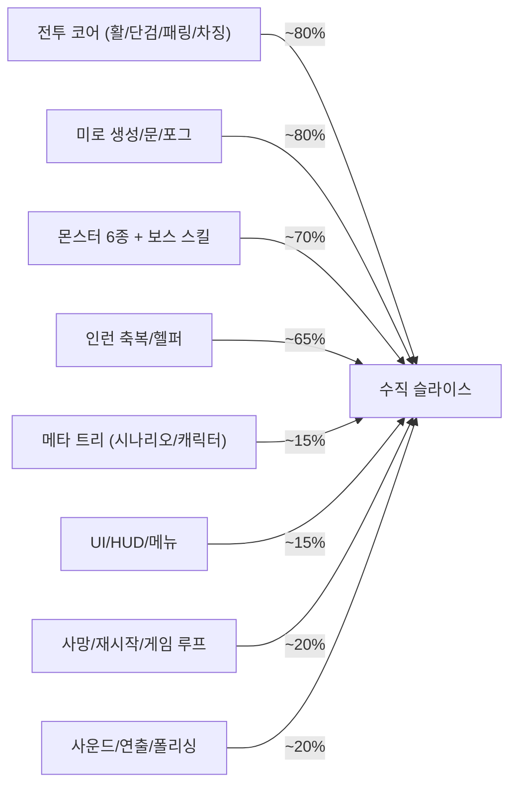

# 《거타지의 전설》 프로젝트 종합 평가

> [!NOTE]
> 정적 분석 결과입니다. 코드와 문서, 데이터 에셋, CSV, 프로젝트 설정을 읽어서 평가했고, Unity 에디터에서 실행해 보지는 않았습니다.
> 직접 읽은 핵심 파일은 다음과 같습니다.
> - `MonsterAI`(일부 구간), `PlayerController`, `BowWeapon`, `Projectile`
> - `MazeGenerator`(일부 구간), `GameManager`, `SaveSystem`
> - 데이터 SO와 에디터 툴, 성장 매니저 3종, `ProgressionDebugUI`, `StageClearUI`
>
> 포그, 헬퍼, 룸 웨이브, VFX 쪽은 문서와 grep으로만 확인했습니다.

## 1. 한 줄 총평

**"재미 핵심(전투 감각)과 절차 생성 뼈대는 상당히 빠르게 잘 올라온 프로토타입. 그러나 메타 루프(죽음→복귀→성장)가 비어 있고, 데이터 파이프라인에 '조용히 데이터를 파괴하는' 함정이 있으며, 버전 관리가 없다."**

| 영역 | 점수 | 코멘트 |
|---|---|---|
| 기획 컨셉 | 8 / 10 | 차별화된 IP, 조작·전투 설계가 명확 |
| 전투/게임플레이 구현 | 7 / 10 | 풍부하지만 몬스터 AI가 거대 클래스 |
| 던전 생성 | 8 / 10 | 검증 파이프라인이 좋음 |
| 데이터 관리 | 5.5 / 10 | 설계 방향은 좋으나 소스가 4중으로 분산 |
| 메타/성장 시스템 | 3 / 10 | 데이터 구조만 있고 실제 연결이 안 됨 |
| UI/UX | 3 / 10 | 전부 IMGUI 디버그 수준 |
| 문서 | 7 / 10 | 풍부하나 중복·불일치 |
| 프로젝트 인프라 | 2 / 10 | VCS, 테스트, 어셈블리 분리 없음 |

---

## 2. 기획 컨셉

### 강점
- **IP 차별성**: 삼국유사 거타지 설화에 산해경 요괴(주, 구미호)를 결합했습니다. 인디 시장에서 눈에 띄는 소재이고 보스·잡몹 세계관 연결이 자연스럽습니다.
- **조작 설계가 선명함**: WASD 이동에 마우스 조준 트윈스틱을 쓰고, 활(5연사/차징) + 단검(패링 반사) + GCD 0.5s/0.2s 규칙이 있습니다. "활로 카이팅하다 위기에 단검으로 투사체를 반사한다"는 한 줄 판타지가 분명합니다.
- **3중 성장 구조**: 영구 불가역 트리, 리셋 가능한 트리, 런 한정 축복을 둔 것은 Hades 류 메타 구조와 잘 맞습니다.
- **헬퍼가 보석을 수집하는 아이디어**는 독특합니다. 위험 구역을 피해 보석을 줍는 헬퍼가 레벨업 타이밍을 좌우하게 됩니다.

### 우려 / 모순
1. **"문은 한번 열리면 영구 개방 + 요괴는 한번 인식하면 영원히 추격 + 전 방 사전 스폰"** 조합은 위험합니다.
   - 36방 × 6~10마리 = **약 250마리**가 동시에 존재합니다.
   - 어그로가 전파되면 한 방향으로 눈덩이처럼 몰려와, 미로의 "잠금/열쇠" 설계가 무의미해질 수 있습니다.
   - 방 3웨이브(60초) 시스템과 합치면 밀도가 폭증합니다.
   - 문서 03은 함정방이 `CombatLock`으로 잠긴다고 하면서 "한번 열린 문은 절대 닫히지 않는다"고도 쓰고 있어 **규칙이 모순**됩니다.
2. **밸런스 신호가 약함**
   - 구미호 보스 HP는 350입니다. 플레이어의 5연사 DPS는 약 80이어서 **약 4~5초면 처치**됩니다.
   - 잡몹 35HP는 화살 2발이면 끝납니다.
   - 반면 몬스터 레벨은 5분마다 HP +20%인데, 미로 탐색 시간 대비 이 곡선이 의미 있는지 검증이 필요합니다.
3. **게임 루프의 목적이 불명확**: 클리어하면 곧바로 던전을 재생성합니다. 챕터, 허브, 타이틀은 enum에만 있습니다.
4. 플레이어가 보석을 직접 줍지 못하고 **헬퍼에게만 의존**합니다. 헬퍼가 도망 상태이면 성장이 막히므로, 이 의존성이 재미를 해칠지 일찍 플레이테스트해야 합니다.

---

## 3. 데이터 관리 방식

### 좋은 점
- ScriptableObject 테이블을 `GameDataManager`가 `Resources/Data`에서 로드하는 구조입니다. 인스펙터에서 튜닝할 수 있고 `Tooltip`이 충실합니다.
- 보스/희귀도/축복을 데이터화했고, 희귀도 `MultiplyValue`/`FixedValue` 분리는 설계가 깔끔합니다.
- `JsonUtility` 기반 세이브 + 영구/런 데이터 분리가 명확합니다.

### 🔴 문제점 (심각도 순)

**① 같은 수치가 4곳에 따로 있고, 서로 값이 다릅니다.**
- 출처 4곳은 `MythOfGuotajiPrefabAndTableGenerator` 하드코딩, `MonsterStatsTableSO.GetStat` 폴백, `.asset` 파일, CSV입니다.
- Minion 공격사거리는 generator 2.0, 폴백 5.0, asset 5, CSV 1.3입니다.
- BigMon 공격사거리는 generator 2.0, 폴백 20, CSV 2입니다.
- `heartHealAmount`는 SO 5, `MonsterAI` 폴백 25, 문서 5입니다.
- 어느 것이 진실인지 알 수 없어, 도구를 돌릴 때마다 게임이 달라질 수 있습니다.

**② CSV 임포트가 데이터를 파괴합니다 (버그).**
- `ImportMonsterStats`는 `table.entries.Clear()` 후 13개 컬럼으로 **새 엔트리를 만듭니다**.
- 그 결과 `gemDropCount`, `expPerGem`, `dashDistance`, `telegraphDuration`, `flightDuration`, `kiteDistance`, `knockbackPower`, `heartDropChance` 등이 **전부 기본값으로 초기화**됩니다.
- 커밋된 `MonsterStats.csv`에는 Minion_Zhu 행이 없습니다. 임포트하면 주(鴸)가 테이블에서 사라지고 폴백값으로 동작합니다.
- 커밋된 `WeaponStats.csv`의 Dagger는 cooldown 0.85, radius 4.2입니다. SO는 0.5, 3.0입니다. 임포트하면 **전투 수치가 조용히 바뀝니다.**

**③ CSV가 전체 테이블의 일부만 다룹니다.**
- 9개 테이블 중 4개(Player, Weapon, Monster, DungeonConfig)만 CSV로 다룹니다.
- `InRunBoonTable`, `BoonRarityTable`, `MonsterSkillVFXTable`, `HelperData`, `FogConfig`는 CSV 밖입니다.
- Player CSV에는 GCD와 하트 필드가 없고, Weapon CSV에는 차징/연사/반사 필드가 없습니다.

**④ `Generate All Prefabs and Tables`는 파괴적인 도구입니다.**
- 수치 에셋을 하드코딩 값으로 덮어써서, 디자이너가 조정한 값이 사라집니다.
- 프리팹을 **캡슐 프리미티브로 다시 만들어 저장**합니다. 실제 `Player_Guotaji`/몬스터 프리팹에 적용한 CatPlayer 스킨과 몬스터 모델이 날아갈 수 있습니다.
- `[InitializeOnLoadMethod]`가 `PrefabDatabase.asset`이 없으면 **자동 실행**까지 합니다.
- 문서 06은 이 도구를 "완전 프리팹 파이프라인"이라고 소개하지만, 실제로는 초기 프로토타입 생성기입니다.

**⑤ 문서에 있는 프리팹이 실제 폴더에 없습니다.**
- 문서 06은 `ChargedArrow_Projectile`, `Helper_Companion`, `ExpGem` 프리팹을 나열합니다.
- `Resources/Prefabs/`에는 12개만 있고 이 셋이 없습니다.
- 그래서 `PrefabDatabase.asset`의 `chargedArrow`, `helperCompanion`, `expGem` 필드가 비어 있고, 코드는 **런타임 프리미티브 폴백**으로 동작합니다.
- 또 `Arrow_Charged`(generator)와 `ChargedArrow_Projectile`(문서)처럼 이름이 불일치합니다.

**⑥ 세이브 시스템이 단순합니다.**
- 스키마 버전이 없습니다. 임시 파일에 쓴 뒤 교체하는 안전 저장도 없어, 쓰기 도중 크래시가 나면 세이브가 손상됩니다.
- 로드 실패 시 곧바로 **기본 세이브로 덮어씁니다.** 손상된 파일을 백업하지 않습니다.
- 디버그 치트(`affinityPoints += 5`)는 저장 없이 메모리만 바꿉니다.

**⑦ 몬스터 풀 키가 `prefab.name`입니다.** 이름이 같은 프리팹이 있으면 충돌합니다.

---

## 4. 코드 리뷰

### 구조적 평가
- 네임스페이스(`Actor/Combat/Core/Data/Dungeon/Progression/UI`)와 폴더 구조가 일관되고, `IDamageable`/`IReflectable` 인터페이스 도입도 좋습니다.
- **주석과 의도 설명이 충실합니다.**
- `DungeonBootstrapper`가 `RuntimeInitializeOnLoadMethod`로 씬을 자동 조립하는 것은 프로토타입에는 빠르지만, **씬에서 편집이나 시각 확인이 불가능**하고 의존 순서가 암묵적입니다.
- **단일 `Assembly-CSharp`**입니다. asmdef가 없어 컴파일 시간이 늘고 Editor/Runtime 경계가 느슨합니다.

### 🔴 실제 버그 / 기능 미작동 (코드 근거 확인됨)

| # | 증상 | 근거 |
|---|---|---|
| 1 | **사망 시 아무 일도 안 일어남** | `PlayerController.Die()`가 `SetState(StageFailed)`만 합니다. 이 상태를 처리하는 UI나 로직이 없고 `FailStage()`는 호출되지 않습니다. 재시작 경로가 없습니다. |
| 2 | **런 축복이 다음 런으로 누수** | `ResetInRunProgress()`는 매니저 수치만 초기화합니다. 플레이어의 `_maxHp`, 이속, `arrowCount`, `pierceCount`와 `RecoveryHeart`의 **static** `BonusHealAmount`/`DropRateMultiplier`는 그대로입니다. 문서의 "스테이지 종료 시 100% 소멸"과 다릅니다. |
| 3 | **첫 스테이지에서는 런 초기화 이벤트가 안 뜸** | `GameManager`의 초기 상태가 이미 `InStage`입니다. `StartStage()`의 `SetState(InStage)`는 early-return이어서 `HandleGameState`가 호출되지 않습니다. |
| 4 | **캐릭터 트리 리셋이 효과 없음** | `ApplyStatBonus`는 **누적 가산**입니다. 투자할 때마다 총합이 다시 더해져 중복 적용되고, 리셋은 0을 더할 뿐 되돌리지 못합니다. 문서의 "100% 환급 리셋"은 포인트만 환급됩니다. |
| 5 | **저장된 스킬이 시작 시 적용 안 됨** | `ApplySkillsToPlayer()`는 투자/리셋 시에만 호출됩니다. 게임 시작/로드 시에는 호출되지 않습니다. |
| 6 | **트리 SO 미연결** | `ScenarioTreeManager._treeData`, `CharacterTreeManager._currentTree`는 SerializeField인데, 부트스트래퍼가 `AddComponent`로 만들어서 **항상 null**입니다. 시나리오/캐릭터 트리는 실질적으로 동작하지 않습니다. 해금 UI도 없습니다. |
| 7 | **`StageClearUI`의 `Input.anyKeyDown`** | `activeInputHandler: 1`(새 Input System만)이므로 **InvalidOperationException**이 납니다. 클리어 화면에서 키 입력 전까지 매 프레임 예외가 쌓입니다. |
| 8 | **단검 반사 배율 미사용** | `DaggerWeapon._reflectDamageMultiplier`는 대입과 `+=`만 있고 읽는 곳이 없습니다. `Projectile.Reflect`가 `×1.5`로 하드코딩되어 있습니다. 테이블 값과 `달빛 패링` 축복이 효과가 없습니다. |
| 9 | **`신속한 당김`(QuickDraw) 축복 미적용** | `chargeSpeedBonus`가 계산만 되고 플레이어에게 적용되지 않습니다. 그래도 카드로 뽑힙니다. |
| 10 | **`ObjectPoolManager.Awake` 조건 오타** | `Instance != null && Instance != null`은 `!= this`여야 합니다. |
| 11 | **보상 하드코딩** | 보스 사망 시 `CompleteStage(5, 100)`이 하드코딩입니다. 테이블의 `affinityReward`, `goldReward`는 보스 클리어에 쓰이지 않습니다. |
| 12 | `GameManager.HasBossKey` 등 런 상태가 `DontDestroyOnLoad` 싱글톤에 있어, 씬 리로드 설계 시 상태 오염 위험이 있습니다. |

### 🟠 성능 / 유지보수
- **`MonsterAI.cs` 약 2,400줄**은 전형적인 God class입니다.
  - 이동, 어그로, 6종 공격, 텔레그래프 생성, 애니메이션 문자열 탐색, 사망 처리가 한 파일에 있습니다.
  - 몬스터 타입 분기(`if _type == ...`)가 곳곳에 있습니다. 전략/컴포넌트 분리(`IAttackBehaviour`)를 권장합니다.
- 250마리 사전 스폰에 몬스터마다 `Update`에서 다음을 수행합니다.
  - `Physics.OverlapSphere`(할당 발생)와 `GetComponent`로 분리 벡터를 계산합니다.
  - `Raycast`로 시야를 검사합니다.
  - 길 갱신마다 BFS(`GetNextWaypointTowards`)를 돌립니다.
  - 비어그로 몬스터도 매 프레임 `CheckPlayerInSight`를 실행합니다.
  - 모두 **스태거링/LOD/비활성화 없이** 돕니다. 사전 스폰 방식에서는 거리 기반 sleep이 필요합니다.
- `Debug.Log`가 피격, 투사체, 몬스터마다 호출됩니다. 에디터와 빌드에서 상당한 GC·IO 비용입니다.
- `ClearExistingDungeon`이 `FindObjectsByType<GameObject>`로 **씬 전체를 훑고 이름 문자열**(`"Telegraph"`)로 정리합니다. 취약한 방식입니다.
- 리플렉션으로 private 필드를 설정합니다(`SetRoomSocketPrivateField`). 세터를 쓰는 편이 안전합니다.
- 머티리얼 `_rend.material`을 직접 접근해 인스턴스 누수 가능성이 있고, `MaterialPropertyBlock` 권장입니다.
- `target.GetHashCode()` 대신 `GetInstanceID()`를 쓰는 편이 안전합니다.
- UI 전체가 **OnGUI(IMGUI)**입니다. HUD, 보스바, 축복 선택창까지 모두 같고 매 프레임 GC를 만듭니다. 프로토타입 이후에는 uGUI/UI Toolkit 교체가 필요합니다.
- 한글 문자열이 코드에 하드코딩되어 있습니다. `com.unity.localization`이 설치되어 있지만 사용하지 않습니다.

### 🟢 잘된 점
- 미로 생성 `ValidateDungeonFlow` 5종 검증과 재시도, 비상 던전 폴백은 **방어적 설계가 훌륭**합니다.
- 보스방 단일 진입 보장(Dead-end), 핵심 알고리즘 설명 주석이 있습니다.
- `Projectile`의 SphereCast + Trigger 이중 검출과 중복 타격 방지, 풀링 반환이 있습니다.
- 몬스터 텔레그래프의 생명주기(사망/비활성화 시 정리)를 신경 썼습니다.
- 볼리 단위 다중타격 점감과 GCD 카테고리 구조가 명확합니다.

---

## 5. 기타

### 🔴 버전 관리(VCS)가 없음
- `.git`, `.plastic` 모두 없고, 상위 폴더에도 없습니다. `Library`, `Temp`, `obj`, `.vs` 같은 생성물이 섞여 있습니다.
- 파일 수 약 1,500개 meta, 수십 MB의 FBX/PSD가 있는데 **백업/롤백 수단이 없습니다.** 위 ④의 파괴적 도구 위험과 겹치면 치명적입니다.
- 최우선으로 `git init` + Unity용 `.gitignore`(+ 필요 시 Git LFS)를 권합니다.

### 문서 (`_Docs_`)
- 문서 7개가 **3벌 중복**되어 있습니다. 내용은 서로 다릅니다.
  - `_MythOfGuotaji_/_Docs_`가 최신입니다(02번이 19KB).
  - `MythOfGuotaji/_Docs_`는 중간 버전입니다(02번 6.9KB).
  - `MythOfGuotaji/_Docs_/_Docs_`는 구버전입니다(06번이 없음).
- 내용 불일치는 다음과 같습니다.
  - 플레이테스트 가이드는 **4×4** 미로라고 쓰는데, 실제와 문서 03은 **6×6**입니다.
  - 포그 문서는 문 너비 6m, 다른 곳은 12m입니다(셰이더 문서 일부가 낡음).
  - 코드 주석은 "차징 최대 2초"/"0.8초 홀드/1.5초"라고 쓰는데, 구현은 3.0초/0.3초입니다.
  - Input System 버전이 1.20.0으로 적혀 있는데 실제는 1.20.1입니다.
  - 문서 03의 섹션 번호가 중복됩니다(4번이 3개).
  - 문서가 `Assets/_MythOfGuotaji/Data/` 샘플 에셋 경로를 말하는데, 실제 폴더가 없습니다.
- **문서가 "완성된 것"처럼 서술**되어 있지만 6번 버그 목록처럼 실제로는 미연결인 항목이 많습니다. "구현됨/부분/미구현" 상태 표시가 필요합니다.

### 에셋/리포 위생
- `VFX_Klaus` 팩이 `ArtAssets/FX`, `ArtAssets/VFX`, `Resources/VFX` **3곳에 중복**됩니다(`VFX_Lab` 씬도 2개). 몬스터 에셋 폴더도 `MonsterAssets`/`NewMonsterAssets`로 나뉩니다.
- `Resources/`에 VFX 100개 프리팹이 있어 **모두 빌드에 포함**됩니다(`Resources`는 사용 여부와 무관하게 포함). Addressables 또는 참조 방식으로 바꾸는 편이 좋습니다.
- `ArtAssets/TweenScript/` 안에 서드파티(`ParticleEffectForUGUI` 1.2MB 데모 씬 포함)와 무관한 스크립트(`WarpTextExample`, `PrefabLightmapData`)가 섞여 있습니다. 상용 에셋의 **라이선스 재배포**도 확인해야 합니다.
- 미사용 패키지가 있습니다: `ai.assistant`(pre), `cinemachine`, `timeline`, `recorder`, `localization`.
  - 카메라는 직접 구현했고 입력은 `InputSystem_Actions.inputactions`(41KB)를 쓰지 않고 `Keyboard.current`를 직접 읽습니다.
- **테스트가 0개**입니다. 미로 생성, 세이브, 희귀도 롤, 점감 공식처럼 순수 로직 영역은 EditMode 테스트 대상으로 아주 적합합니다.
- 씬이 `SampleScene` 하나뿐입니다. 타이틀/허브/인게임 분리가 없고 빌드 설정에도 하나만 있습니다. `GameState.Title/Hub`는 미사용입니다.
- `companyName: DefaultCompany`, `bundleVersion 0.1.0`이며 빌드·CI 설정은 없습니다.

---

## 6. 진행도 평가 (대략)

현재는 **"전투 샌드박스 + 절차 던전" 단계**입니다. 코어 반복 루프(입장→전투→클리어)는 돌아가지만, 로그라이크의 핵심인 **죽음→복귀→성장 루프는 닫히지 않았습니다.**

---

## 7. 우선순위 로드맵

### P0 (오늘~이번 주 / 방어)
1. **`git init` + `.gitignore`(+LFS)**로 첫 커밋을 만듭니다.
2. 문서 3벌을 **하나로 통합**하고 나머지는 삭제합니다.
3. `Generate All Prefabs and Tables`에 **덮어쓰기 확인/비활성화**를 추가합니다. 특히 프리팹 생성은 "없을 때만 생성"으로 바꿉니다. `InitializeOnLoad` 자동 실행도 끕니다.
4. `StageClearUI`의 `Input.anyKeyDown`을 제거합니다. (1줄)

### P1 (1~2주 / 루프 닫기)
5. 사망 처리를 구현합니다: 사망 UI → `FailStage` → 런 상태 완전 초기화(플레이어 스탯과 static 포함).
6. **런 상태를 분리**합니다. 플레이어의 런 스탯을 `RunStats` 객체로 모아 리셋을 한 줄로 만듭니다. `RecoveryHeart`의 static도 제거합니다.
7. 트리 SO 에셋을 생성해 매니저에 연결하고, `ApplySkillsToPlayer`를 **재계산 방식**(base + 보너스 재산출)으로 바꾸며 로드 시에도 호출합니다.
8. 단검 반사 배율/`QuickDraw` 등 **작동하지 않는 축복**을 연결합니다.
9. 데이터 소스를 **단일화**합니다. SO를 유일한 원천으로 두고, 코드 폴백과 generator의 하드코딩을 제거합니다. 최소한 하나의 경고 로그는 남깁니다.
10. CSV 임포터를 **필드 리플렉션 기반 전 필드 매핑**으로 바꾸고, 병합(기존 엔트리 업데이트) 방식으로 합니다. 전체 테이블을 포함하세요.

### P2 (수주 / 품질)
11. `MonsterAI`를 행동 컴포넌트(이동/어그로/공격 전략)로 분해합니다. 몬스터에 거리 기반 sleep과 틱 분산을 적용해 사전 스폰 250마리에 대응합니다.
12. 어그로 규칙을 재검토합니다: 영구 추격 대신 "추격 포기 거리"나 방 단위 어그로 등을 플레이테스트로 결정합니다. 문 규칙 모순(문서 03)도 정리합니다.
13. 밸런스 시뮬레이션 시트를 만들어 DPS, TTK, 몬스터 레벨 곡선을 점검합니다.
14. asmdef 분리(Runtime/Editor/Tests)와 EditMode 테스트(미로 검증, 희귀도, 세이브)를 추가합니다.
15. IMGUI를 uGUI/UI Toolkit으로 교체하고 Localization을 도입합니다.
16. 세이브 버전 필드, 원자적 저장, 손상 시 백업을 추가합니다.
17. VFX 중복을 정리하고 `Resources`에서 Addressables로 이동합니다. 미사용 패키지를 정리하고 에셋 라이선스를 확인합니다.

---

## 8. 결론

- **방향은 옳습니다.** 컨셉이 분명하고 전투/던전 코어 구현 속도가 인상적입니다. 방어적 검증 설계와 데이터 주도 지향도 좋습니다.
- 지금 가장 큰 위험은 기능 부족보다 **"조용한 데이터 파괴 + 버전 관리 부재"**입니다. P0를 먼저 처리하세요.
- 그다음은 **사망→복귀 루프와 런 상태 리셋**입니다. 로그라이크가 성립하려면 이 두 가지가 가장 먼저 닫혀야 합니다.
- 메타 트리와 UI는 이 루프가 닫힌 뒤 붙여도 늦지 않습니다.
